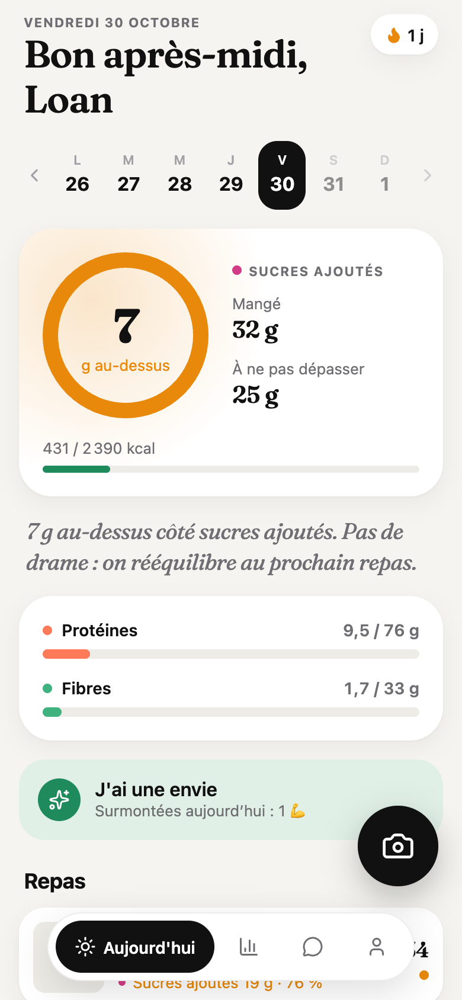
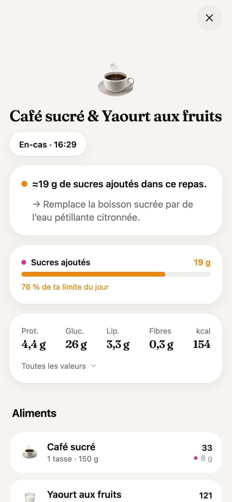
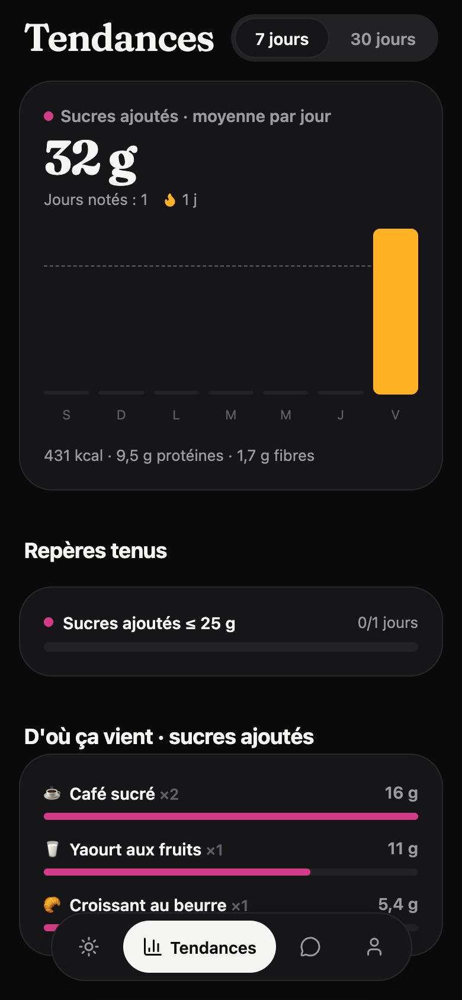

<p align="center">
  
  
  
</p>

# Symbiose

**Eat mindfully, not by counting.** Symbiose is an open-source, AI-first companion for your daily life. Its first module is meal tracking that adapts to *your* goals: snap your plate, and it works out the rest.

Tell it what you want in your own words ("I want to cut sugar, I eat it by reflex in the afternoon", "lean bulk", "lose weight without frustration") and Symbiose turns it into a precise, safe plan, puts the numbers that matter for *you* first, and gives goal-aware feedback on every meal.

- **Two gestures to log a meal.** Tap the camera, shoot. The meal appears at once while the AI analyses it in the background.
- **Goal-driven, not calorie-driven.** If your goal is cutting sugar, the home screen shows your added-sugar budget, not calories. Weight goals put energy first.
- **Precise where it matters.** Nutrients are stored per 100 g and rescaled exactly when you change a portion; AI output is sanity-checked (Atwater energy check, sugar ⊂ carbs, etc.); the AI asks at most one question when the answer would change the estimate ("How many sugars in the coffee?"); barcodes use Open Food Facts.
- **Fix anything in one sentence.** "No sugar in the coffee, half the fries" and the meal is re-analysed.
- **Cravings, not guilt.** "I have a craving" gives you a tip and an alternative right now, tracks what you resisted, and shows *where* and *when* your sugar comes from.
- **Your watch, connected.** Apple Watch via Apple Health, Wear OS / Garmin / Fitbit / Samsung via Health Connect: steps, active energy and weight flow in, your meals flow out, and your energy budget can follow your real activity.
- **A coach that knows your day**, and a weekly AI review with concrete experiments.
- **Self-hosted, one container.** Your data lives on your server, in one SQLite file and a photos folder.

## Self-host the server

```bash
docker run -d --name symbiose -p 3000:3000 \
  -e ANTHROPIC_API_KEY=sk-ant-... \
  -v symbiose-data:/data \
  ghcr.io/synapsr/symbiose:latest
```

Or with Compose: `docker compose up -d` (see [docker-compose.yml](docker-compose.yml)).

Open `http://<your-server>:3000`: the page shows a QR code. In the app, tap **Scan the server QR code** and create your account. The first account is the admin; sign-ups then close unless `ALLOW_SIGNUP=true`.

| Variable | Default | |
| --- | --- | --- |
| `ANTHROPIC_API_KEY` | — | Enables photo/text analysis, plans, coach, reviews. Without it, the app still works (barcodes, manual logging, keyword-based plans). |
| `ANTHROPIC_WORKSPACE_ID` | — | Only for API keys that aren't scoped to a workspace (Claude Console → Settings → Workspaces). |
| `AI_MODEL` | `claude-opus-5-5` | Any Claude model id. |
| `PUBLIC_URL` | derived from the request | URL encoded in the QR code (set it behind a reverse proxy). |
| `ALLOW_SIGNUP` | `false` | Allow more accounts after the first one (family server). |
| `DATA_DIR` | `/data` | SQLite database, photos and generated JWT secret. Back up this folder. |
| `JWT_SECRET` | generated once | Override the token signing secret. |
| `PORT` | `3000` | |
| `AI_MOCK` | `false` | **Development only**: canned AI answers so you can work on the UI without a key. |

Updating is `docker pull` + restart: migrations run automatically at start-up.

## The mobile app

The app is built with Expo (React Native). It needs a development build because it uses native modules (camera, HealthKit, Health Connect):

```bash
pnpm install
pnpm --filter @symbiose/mobile ios       # or: android
# or in the cloud: cd apps/mobile && npx eas-cli@latest build --profile development
```

It also runs in a browser for UI work (`pnpm dev:mobile` then press `w`); health features are disabled there.

## Develop

Requirements: Node 22+ (`nvm use`), pnpm 10, Docker (optional).

```bash
pnpm install
cp apps/server/.env.example apps/server/.env   # add your key, or set AI_MOCK=true
pnpm dev:server                                # http://localhost:3000
pnpm dev:mobile                                # Expo dev server
pnpm typecheck && pnpm test && pnpm lint
docker build -t symbiose .                     # the production image
```

```
apps/server     Hono + SQLite (Drizzle) API, Claude integration, one Docker image
apps/mobile     Expo Router app (iOS, Android, web)
packages/shared Types, zod schemas, nutrition math shared by both
docs/           Architecture, wearables, competitive analysis
```

Read [docs/architecture.md](docs/architecture.md) for how meals are analysed and how targets are computed, and [docs/wearables.md](docs/wearables.md) for the watch integration.

## Privacy

Meal photos and descriptions are sent to the AI provider (Anthropic) for analysis and nothing else; everything else stays on your server. You can export all your data as JSON or delete your account from the app.

Symbiose is not a medical device. Plans are conservative by design (calorie floors, capped deficits), but if you have a medical condition, are pregnant or have a history of eating disorders, ask a professional before following any nutrition target.

## Roadmap

- watchOS / Wear OS companion: complication with your focus metric, one-tap re-log, voice logging from the wrist
- Home-screen widgets and Live Activities
- Offline queue for meals taken without network
- CIQUAL (ANSES) food database for generic foods; pluggable AI providers (local models)
- Adaptive energy expenditure from weight trend (MacroFactor-style)
- More life modules: sleep, hydration, training, mood

## License

[MIT](LICENSE)
