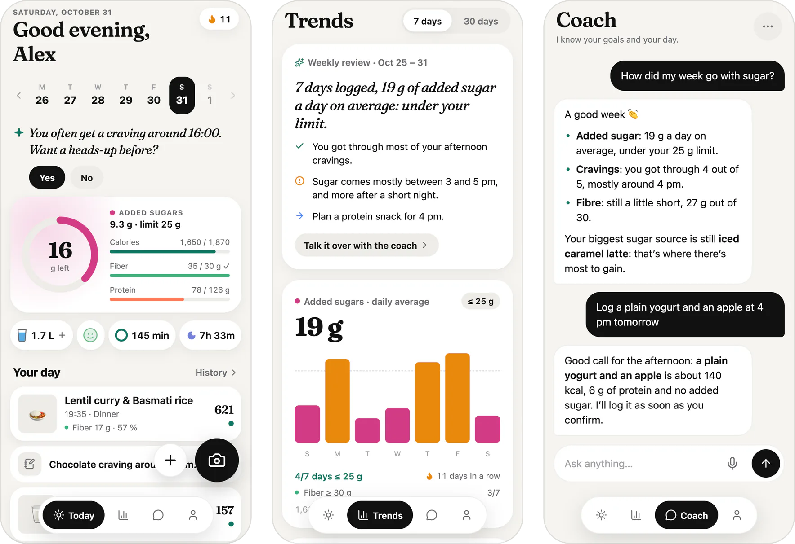
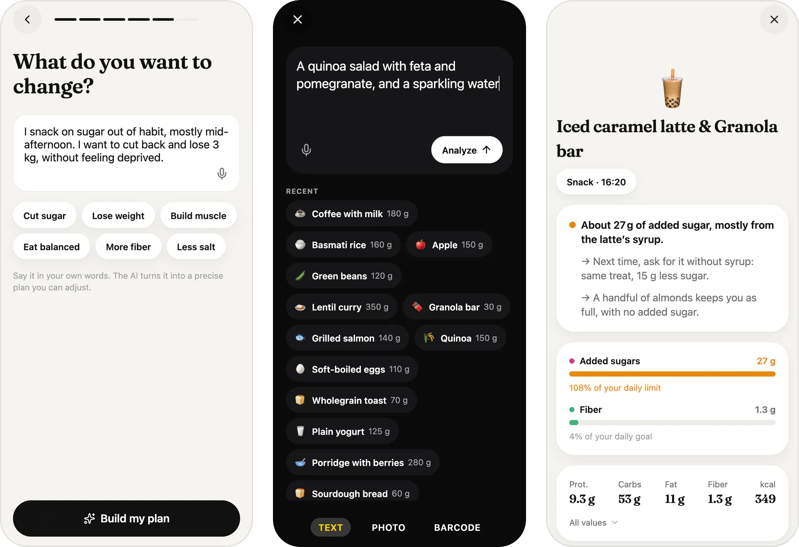
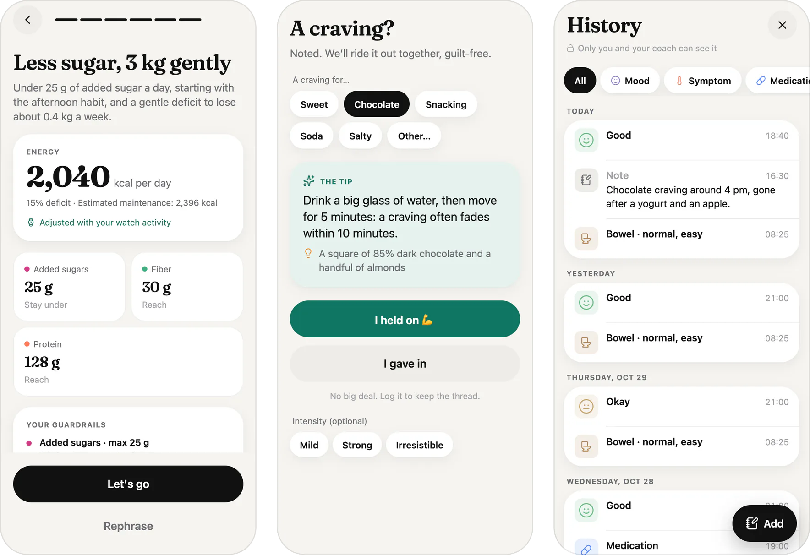
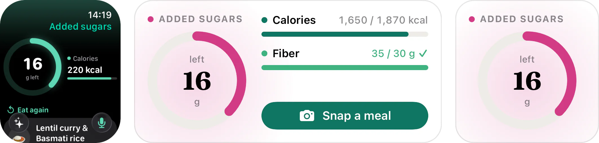
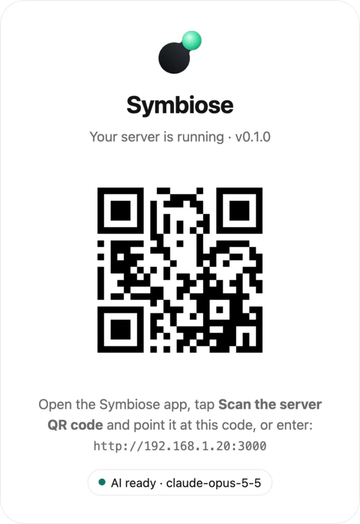
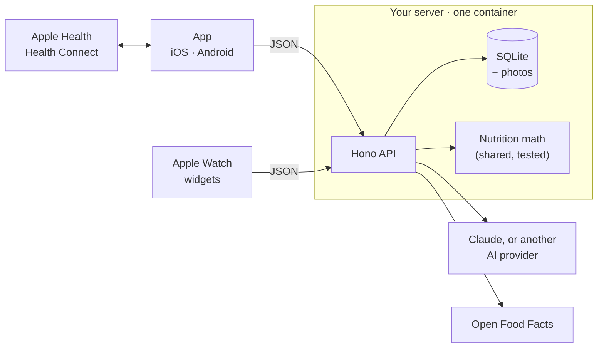

<h1 align="center">
  <a href="https://symbiose.synapsr.io">
    <picture>
      <source media="(prefers-color-scheme: dark)" srcset="docs/brand/lockup-dark.svg" />
      
    </picture>
  </a>
</h1>

<div align="center">

**Your health goals, in your own words.**<br />
Snap, say or scan a meal: an AI follows *your* goal, on *your* server.

[](https://github.com/Synapsr/Symbiose/actions/workflows/ci.yml)
[](LICENSE)
[](#get-the-app)
[](#self-host-in-one-command)
[](CONTRIBUTING.md)

[**Website**](https://symbiose.synapsr.io) · [**Self-host**](#self-host-in-one-command) · [**Docs**](docs/) · [**Contributing**](CONTRIBUTING.md)

</div>

<p align="center">
  <picture>
    <source media="(prefers-color-scheme: dark)" srcset="docs/screenshots/hero-dark.webp" />
    
  </picture>
</p>

## What is Symbiose?

Symbiose is an open-source app for eating the way **you** decided to. Write your goal as you'd say it, "cut the afternoon sugar" or "lose 3 kg without feeling deprived", and it becomes a precise, safe plan, with the numbers that matter to you first.

Log a meal with a photo, a sentence or a barcode. The AI works out portions and nutrients, plain code checks every number, and each meal gets one line of feedback that fits your goal. A coach that knows your day answers your questions, and helps you ride out a craving.

It runs on your own server: one Docker container, one SQLite file, with Claude or the AI provider of your choice. iPhone, Android, Apple Watch, widgets, in French and English. No subscription, no ads, no tracking.

## How it works

1. **Say what you want to change**, in your own words. Symbiose drafts the plan: an energy budget, a few guardrails (say, added sugar under 25 g), small habits. Adjust anything.
2. **Snap, say or scan a meal.** A photo, a sentence you type or dictate, or a barcode. The meal shows up at once and is analysed in the background, even if you were offline.
3. **See what counts for you.** Today puts your goal's number first, each meal gets feedback and a tip, and the coach knows your goals, your meals and your week.

<p align="center">
  <picture>
    <source media="(prefers-color-scheme: dark)" srcset="docs/screenshots/how-dark.webp" />
    
  </picture>
</p>

## Features

| Feature | What it does |
| --- | --- |
| **Goal-first home** | Today shows the number your goal is about: added sugar if you're cutting sugar, energy to lose weight, protein to build muscle. Calories can be hidden altogether. |
| **Precise numbers** | Nutrients are stored per 100 g and rescaled exactly. AI estimates are checked by code (energy against macros, added sugar within sugar within carbs), and the AI asks at most one question, only when the answer changes the result. Barcodes come from Open Food Facts. |
| **Fix a meal in one sentence** | "No sugar in the coffee, half the fries", and the meal is analysed again. |
| **Cravings, not guilt** | « I have a craving » gives a tip and an alternative right away, and a ten-minute Live Activity to ride it out. Trends show which foods and which hours your sugar comes from. |
| **Coach and morning check-in** | Ask anything: the coach knows your goals, meals, sleep and activity, and can log or fix a meal once you confirm. If you like, it writes a short check-in each morning and a heads-up before your usual craving hour. |
| **Weekly review** | What went well, what keeps coming back, and what to try next. |
| **Life modules, opt-in** | Sleep, water, mood and blood pressure, plus a private health journal. The coach only hears about what you turned on. |
| **Health and adaptive energy** | Apple Health and Health Connect: steps, workouts and weight in, meals out. Your budget can follow your activity and, over the weeks, what you really burn. |
| **Apple Watch, widgets, Live Activity** | Your number on the wrist, the Home Screen and the Lock Screen. Eat again in one tap, dictate a meal from the watch, log a craving from Control Center. |
| **Offline queue** | No network? Meals wait on the phone with their time, then send themselves. |
| **Voice dictation** | Dictate meals, notes and questions. On iPhone, recognition stays on the device whenever it can. |
| **French and English, light and dark** | It follows your phone. |

<p align="center">
  <picture>
    <source media="(prefers-color-scheme: dark)" srcset="docs/screenshots/more-dark.webp" />
    
  </picture>
</p>

<p align="center">
  <br />
  <picture>
    <source media="(prefers-color-scheme: dark)" srcset="docs/screenshots/devices-dark.webp" />
    
  </picture>
</p>

## Self-host in one command

```bash
docker run -d --name symbiose -p 3000:3000 \
  -e ANTHROPIC_API_KEY=sk-ant-... \
  -v symbiose-data:/data \
  ghcr.io/synapsr/symbiose:latest
```

Or with Compose: `curl -O https://raw.githubusercontent.com/Synapsr/Symbiose/main/docker-compose.yml`, then `ANTHROPIC_API_KEY=sk-ant-... docker compose up -d`.

**That's it.** Open `http://<your-server>:3000`: the page shows a QR code. In the app, tap **Scan the server QR code**, then create your account.

<p align="center">
  <picture>
    <source media="(prefers-color-scheme: dark)" srcset="docs/screenshots/server-dark.webp" />
    
  </picture>
</p>

A handful of variables cover most setups:

| Variable | |
| --- | --- |
| `ANTHROPIC_API_KEY` | Claude, the default AI. |
| `AI_PROVIDER`, `AI_API_KEY` | Another provider instead (below). |
| `PUBLIC_URL` | The address phones use, behind a reverse proxy. |
| `SIGNUP` | `closed` (default: only the first account), `request` (an admin approves) or `open`. |
| `ADMIN_EMAILS` | Accounts that see the admin view: AI cost, usage, server health. |
| `DATA_DIR` | Where the database and photos live (`/data`). |

To update, pull the image and start the container again: migrations run on their own, after a backup of the database in `DATA_DIR/backups/`. Every setting, reverse proxies and backups are in **[docs/self-hosting.md](docs/self-hosting.md)**.

<details>
<summary><b>Other AI providers</b></summary>

Claude is the default and the reference: Symbiose's prompts were tuned on it. Other models work, but may be less precise on portions and nutrients, and small local models much less so. Photo meals need a model that reads images; the coach's proposals need one that calls tools.

| `AI_PROVIDER` | Default `AI_MODEL` | Key |
| --- | --- | --- |
| `anthropic` | `claude-opus-5-5` | `ANTHROPIC_API_KEY` |
| `openai` | `gpt-6-astra` | `OPENAI_API_KEY` |
| `mistral` | `mistral-large-4` | `MISTRAL_API_KEY` |
| `gemini` | `gemini-3.8-flash` | `GEMINI_API_KEY` |
| `openrouter` | `anthropic/claude-opus-5.5` | `OPENROUTER_API_KEY` |
| `ollama` | `gemma4` | none |
| `openai-compatible` | required | optional, with `AI_BASE_URL` |

```bash
docker run -d --name symbiose -p 3000:3000 -v symbiose-data:/data \
  -e AI_PROVIDER=openai -e AI_API_KEY=sk-... ghcr.io/synapsr/symbiose:latest
```

Ollama, LM Studio and other local servers: see [docs/self-hosting.md](docs/self-hosting.md#ai-providers).

</details>

## Get the app

Symbiose isn't on the App Store or Google Play yet. Until then, build it from source on a Mac with Xcode, or with Android Studio:

```bash
git clone https://github.com/Synapsr/Symbiose.git && cd Symbiose
pnpm install
pnpm --filter @symbiose/mobile ios        # or: android
```

This builds the app, with its watch app and widgets on iOS, and opens it in the simulator. Installing it on your own iPhone needs your own Apple signing team.

## Privacy

- **Your data stays on your server**, in one SQLite file and a photos folder.
- **Only what an answer needs goes to the AI provider you chose**: the meal's photo or words, and the context for that answer (your goal, your day's numbers). Never your name, email or password. Barcodes go to Open Food Facts.
- **No analytics, no tracking, no ads**, in the app or on the server.
- **Export everything** as JSON, or **delete your account**, from the app.
- **Not a medical device.** Plans are conservative by design (calorie floors, capped deficits), but if you have a medical condition, are pregnant, or have a history of eating disorders, ask a professional before following any nutrition target.

## FAQ

<details>
<summary><b>Do I need an API key?</b></summary>

For the AI, yes: a key from Anthropic or another provider, which you pay per use, directly. Symbiose takes nothing. A local model through Ollama needs no key at all.

</details>

<details>
<summary><b>Which AI should I use?</b></summary>

Claude, the default: the prompts were written and tuned on it. OpenAI, Mistral, Gemini, OpenRouter, Ollama and any OpenAI-compatible server work too, through one setting. The server's start-up log says which model answers.

</details>

<details>
<summary><b>Does it work without AI?</b></summary>

Yes. Barcodes, manual logging, portions, Trends, Health sync, the watch and widgets all work, and a keyword-based planner turns your goal into a reasonable plan. Photo and text meals, the coach and the reviews need an AI.

</details>

<details>
<summary><b>Can my family share one server?</b></summary>

Yes. With `SIGNUP=open`, anyone who can reach the server gets an account, fine on a home network. With `SIGNUP=request`, you approve each person from the admin view. Each account only ever sees its own data, and the admin view shows totals, never anyone's meals.

</details>

<details>
<summary><b>How is it different from MyFitnessPal or Cal AI?</b></summary>

Symbiose starts from your goal rather than from calories: if you're cutting sugar, sugar is the number you see. AI estimates are checked by code before you see them, a coach knows your whole day, and everything runs on your server. It's open source, with no subscription, no ads and no paywall.

</details>

## Architecture



```
apps/server       Hono + SQLite (Drizzle) API, the AI adapters, one Docker image
apps/mobile       Expo Router app (iOS, Android, web), with the watch app and widgets in targets/
packages/shared   Types, zod schemas and the nutrition math both sides use
website/          The public site (Vite + React)
docs/             Architecture, self-hosting, watch and health, brand
```

How meals are analysed and targets computed: [docs/architecture.md](docs/architecture.md). The watch, widgets and health stores: [docs/wearables.md](docs/wearables.md).

## Develop

Node.js 22 (`nvm use`) and pnpm 10:

```bash
pnpm install
cp apps/server/.env.example apps/server/.env   # add a key, or set AI_MOCK=true
pnpm dev:server                                # API on http://localhost:3000
pnpm dev:mobile                                # Expo; press w to open it in the browser
pnpm typecheck && pnpm test && pnpm lint
```

## Contributing

Bug reports, translations and pull requests are welcome. Start with [CONTRIBUTING.md](CONTRIBUTING.md) (setup, checks, conventions). Symbiose aims to stay simple: before adding a step or a setting, ask whether a better default would do.

- [Report a bug](https://github.com/Synapsr/Symbiose/issues/new?template=bug_report.yml)
- [Suggest an improvement](https://github.com/Synapsr/Symbiose/issues/new?template=feature_request.yml)
- Found a security issue? See [SECURITY.md](SECURITY.md).

If Symbiose helps you eat the way you want, a star helps other people find it.

## Credits

Built with [Expo](https://expo.dev), [React Native](https://reactnative.dev), [Hono](https://hono.dev), [Drizzle](https://orm.drizzle.team) and SQLite. Food data from [Open Food Facts](https://world.openfoodfacts.org), set in [Fraunces](https://github.com/undercasetype/Fraunces). See [THIRD_PARTY_NOTICES.md](THIRD_PARTY_NOTICES.md).

## License

[MIT](LICENSE) © Synapsr
